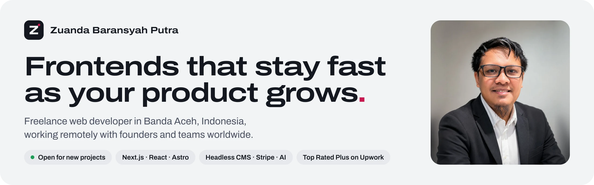

<a href="https://zuanda.web.id">
  <picture>
    <source media="(prefers-color-scheme: dark)" srcset="assets/banner-dark.webp">
    
  </picture>
</a>

  
  
  
  

### Hi, I'm Zuanda 👋

I'm a **full-stack developer who specializes in the frontend**. For more than eight years I've built fast, modern websites and web apps with React, Next.js, Astro and SvelteKit, from headless CMS builds to Stripe payments and AI-powered features. On the backend I work with Node.js, NestJS and Odoo to ship the APIs and integrations behind them.

I work remotely with founders and teams in **Australia, Switzerland and Indonesia** — Top Rated Plus on Upwork with a 100% Job Success Score.

- 🛠️ **Web development** — production sites and apps that are fast, accessible and easy to maintain
- ✍️ **Headless CMS** — Payload, Sanity and Strapi setups that let teams publish without a developer
- ⚡ **Payments, APIs and AI** — Stripe checkout and subscriptions, webhooks, Odoo over GraphQL, AI assistants and RAG
- 🛍️ **Store themes** — Arabic-first, RTL storefront themes for [Salla](https://zuanda.web.id/themes)

### Open source

| Project | What it does |
|---|---|
| [**geo-audit**](https://github.com/zuandabaransyahputra/geo-audit) | Is your site ready for AI search? Free audit of AI crawler access, llms.txt, JSON-LD and SEO basics, with concrete fixes. Web + CLI. [Try it](https://geoaudit-tool.vercel.app) |
| [**qris**](https://github.com/zuandabaransyahputra/qris) | Typed, zero-dependency TypeScript library for QRIS: parse, validate, and turn a static QRIS into a dynamic one with an amount. [Demo](https://qris-ts.vercel.app) |
| [**astro-freelance-portfolio**](https://github.com/zuandabaransyahputra/astro-freelance-portfolio) | Astro portfolio template for freelance developers — motion, service pages with FAQ schema, llms.txt + JSON-LD, Resend contact form. [Live demo](https://astro-freelance-portfolio.vercel.app) |
| [**shadcn-rtl**](https://github.com/zuandabaransyahputra/shadcn-rtl) | RTL- and Arabic-ready components for shadcn/ui, plus SAR/AED prices and Hijri dates, installable with the shadcn CLI. [Docs and demo](https://shadcn-rtl-ui.vercel.app) |
| [**astro-geo**](https://github.com/zuandabaransyahputra/astro-geo) | Astro integration for SEO/GEO: generates llms.txt and llms-full.txt, with typed JSON-LD helpers. |
| [**salla-react-starter**](https://github.com/zuandabaransyahputra/salla-react-starter) | Light starter for Salla React (Twilight) themes: RTL-first shadcn/ui primitives, visual QA matrix, Lighthouse and CI. |

### Selected work

| Project | What it is | Role |
|---|---|---|
| [**Diavaia**](https://zuanda.web.id/work/diavaia) | Global storefront for natural and lab-grown diamonds, 1.3M+ certified stones with faceted search | Frontend lead, team of two |
| [**Cool.org**](https://zuanda.web.id/work/cool-org) | Australia's curriculum-aligned education platform for teachers | Full-stack, Laravel → Next.js migration |
| [**CoolPlus**](https://zuanda.web.id/work/coolplus) | AI lesson builder for teachers with Stripe subscriptions | Full-stack |
| [**Soludoo**](https://zuanda.web.id/work/soludoo) | Multilingual site for a Swiss Odoo consultancy | Astro build |
| [**Monfortelli**](https://monfortelli.ch) | Shop for handmade chocolate truffles from Piedmont, delivering across Switzerland | Astro + Odoo (GraphQL), Tailwind, shadcn/ui |
| [**Wildsocks**](https://wildsocks.prebakedweb.ch) | Online shop for colourful organic-cotton socks from Switzerland | Astro + Odoo (GraphQL), Tailwind, shadcn/ui |
| [**TALD**](https://zuanda.web.id/work/tald) | Marketplace connecting homeowners with vetted interior designers and architects | Frontend |
| [**Higher.id**](https://zuanda.web.id/work/higher-id) | Indonesian services marketplace fronted by an AI assistant | Frontend |
| [**Hendra Syah**](https://hendrasyah.com) | Creator storefront for digital products, online classes, events and consultations | Full-stack, Next.js with its own admin |
| [**Madrasah Imam An-Nawawi**](https://zuanda.web.id/work/an-nawawi) | Website for a four-school Islamic foundation in Aceh | Full-stack, PostgreSQL on a VPS |

More projects and full case studies: **[zuanda.web.id/works](https://zuanda.web.id/works)**

### Own products

- [**Thullab**](https://thullab.com) — a learning platform for Islamic studies where a supervising Syaikh approves every lesson before it goes live. Next.js, Prisma, Cloudflare R2.
- [**Taudhih**](https://taudhih.com) — a reader for Arabic kitab: tap a word for its meaning in context, harakat and i'rab, and a translation in place. Expo + Next.js.
- [**Bersanding**](https://bersanding.com) — a mobile-first wedding invitation builder with RSVP and pay-to-publish.
- [**Catatan Kitab**](https://catatan-kitab.vercel.app) — a local-first PDF reader where every note links back to the text it came from.
- [**Salla themes**](https://zuanda.web.id/themes) — Fawha, Finjani, Nadara, Wamidi, Burda, Hindam, Baqati and Rasidi, each with English and Arabic documentation.

### Tech stack

 

 

### Let's work together

I'm **open for new projects**. Tell me what you're building at **[zuanda.web.id/contact](https://zuanda.web.id/contact)** and I'll reply within 1–2 business days — or reach me on [WhatsApp](https://wa.me/6282277589814), [Upwork](https://www.upwork.com/freelancers/~01c572cdc0382a06c6) or [email](mailto:zuandabaransyahputra@gmail.com).
